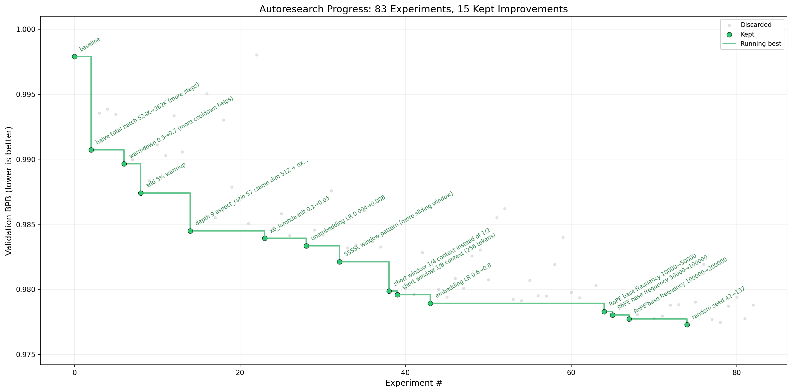

# autoresearch


# Autonomous LLM Research

A minimal framework for running autonomous experiments on a real language model using a single GPU.

An AI coding agent can modify the training code, run a short experiment, evaluate the result, and decide whether to keep or discard the change. Repeating this process over several hours produces a record of experiments and may improve model performance without manual edits to the training script.

The human researcher controls the process through `program.md`, which defines the agent's instructions, objectives, and experimental workflow.

## How It Works

The project centers on three files:

- **`prepare.py`** — Contains fixed constants, one-time data preparation, tokenizer training, data loading, and evaluation utilities. The agent must not modify this file.
- **`train.py`** — Contains the GPT model, optimizers (Muon and AdamW), and training loop. The agent can edit the architecture, hyperparameters, optimization settings, batch size, and other training details.
- **`program.md`** — Contains the instructions that guide the agent's research process. The human researcher edits this file.

Each training experiment uses a **fixed five-minute training budget**, excluding startup and compilation. Performance is measured by **validation bits per byte (`val_bpb`)**. Lower values indicate better results. This metric is independent of vocabulary size, making it useful for comparing different model configurations.

A typical cycle is:

1. Review the current training code and prior results.
2. Propose and implement one experimental change in `train.py`.
3. Train for the fixed five-minute budget.
4. Evaluate the resulting `val_bpb`.
5. Keep the change if it improves the result; otherwise revert it.
6. Log the outcome and begin another experiment.

## Requirements

- One NVIDIA GPU (tested on H100 hardware)
- Python 3.10 or newer
- `uv` for dependency management

## Quick Start

Install `uv` using a trusted installation method before proceeding.

### 1. Install dependencies

```bash
uv sync
```

### 2. Prepare the data and tokenizer

```bash
uv run prepare.py
```

This one-time step downloads the training data and trains the tokenizer. It typically takes around two minutes, depending on the environment.

### 3. Run a training experiment

```bash
uv run train.py
```

A training experiment takes approximately five minutes, excluding startup and compilation.

### 4. Start autonomous research

Open the project in a compatible AI coding-agent environment. Give the agent access to `program.md` and allow it to carry out experiments within the boundaries defined there.

For example, instruct the agent to read `program.md`, verify the environment, and begin its first experiment.

Review the agent's file permissions and execution settings before allowing unattended runs.

## Project Structure

```text
prepare.py       Fixed constants, data preparation, and evaluation utilities
train.py         Model, optimizer, and training loop; modified by the agent
program.md       Research instructions; maintained by the human researcher
pyproject.toml   Project dependencies and configuration
```

## Design Choices

### Single editable training file

The agent modifies only `train.py`. This keeps experiments focused, changes easy to inspect, and reversions straightforward.

### Fixed training budget

Every experiment uses the same five-minute training period. This allows experiments on the same hardware to be compared under a consistent time limit.

In ideal conditions, this provides roughly 12 experiments per hour, although evaluation, agent reasoning, code edits, and other overhead reduce the actual total.

Results are optimized for the available hardware and may not be directly comparable with results from different devices.

### Minimal dependencies

The implementation is designed around PyTorch and a small set of supporting packages. It uses a single GPU without distributed training or a complex configuration system.

### Agent-directed iteration

The agent proposes, tests, and evaluates changes while the human researcher improves the instructions in `program.md`. This separates the experimental workflow from the training code being tested.

## Platform Support

The baseline implementation requires a single NVIDIA GPU. CPU, Apple Silicon, and other accelerator support may require adjustments to device handling, attention implementations, training settings, and evaluation settings.

## Guidance for Smaller Hardware

Smaller GPUs and other constrained systems may need lighter training configurations. Consider the following adjustments:

1. **Use a simpler dataset.** A narrow, lower-entropy text dataset can make smaller models easier to train and evaluate.
2. **Reduce vocabulary size.** Experiment with values such as 4096, 2048, or 1024, or use a byte-level tokenizer with 256 possible byte values.
3. **Shorten the sequence length.** Decrease `MAX_SEQ_LEN` in `prepare.py`, potentially to 256 on highly constrained devices. Adjust `DEVICE_BATCH_SIZE` in `train.py` as appropriate. Tokens processed per forward/backward pass equal the product of these two values.
4. **Reduce evaluation workload.** Decrease `EVAL_TOKENS` in `prepare.py` to shorten validation on slower hardware.
5. **Reduce model depth.** `DEPTH` in `train.py` is a primary control for model complexity. For example, try reducing it from 8 to 4.
6. **Simplify attention patterns.** Try setting `WINDOW_PATTERN` to `"L"` instead of `"SSSL"` if banded attention is inefficient on the target device.
7. **Reduce total batch size.** Try smaller powers of two for `TOTAL_BATCH_SIZE`, such as `2**14` (16,384).

These changes are starting points, not universal defaults. Test them against the available memory, throughput, and validation performance.

## Experiment Evaluation

Use `val_bpb` as the primary metric when comparing training runs on the same hardware and data setup.

Keep an experiment log containing the proposed change, the observed metric, and whether the change was retained. Avoid changing evaluation data or measurement rules between experiments, since that would undermine comparisons.

## License

MIT
